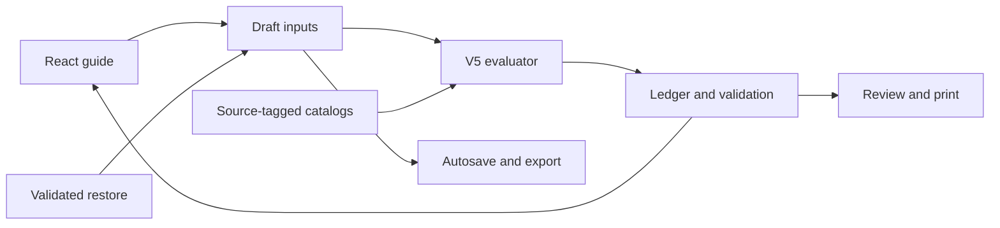

# Architecture

The static Vite app uses React, TypeScript, Tailwind CSS, and shadcn/ui. [`index.html`](../index.html) loads [`src/main.tsx`](../src/main.tsx), which mounts the creator in [`src/App.tsx`](../src/App.tsx). [`vite.config.ts`](../vite.config.ts) registers React and Tailwind and resolves `@/` to `src/`. The theme is in [`src/index.css`](../src/index.css), and [`components.json`](../components.json) points shadcn/ui to the same stylesheet and alias.

The ledger uses stable Attribute and Skill IDs from [`src/catalog/traits.ts`](../src/catalog/traits.ts). Its editor dispatches changes to the in-memory draft in [`src/rules/trait-ledger.ts`](../src/rules/trait-ledger.ts). A pure calculation returns the rating slots, derived tracks, and Specialty eligibility after every edit. The draft retains selections when a distribution change exposes a conflict. Specialties tied to overfilled ratings stay inactive until those ratings fit. The [product plan](../PLAN.md) describes the later modules.

| Area | Responsibility |
| --- | --- |
| React guide | Collect draft inputs, expose the live ledger and step navigation, and show review, print, and share previews. |
| `src/rules/` | Evaluate the draft under its V5 ruleset. Calculate totals, list the source of each grant, and attach issues to affected choices. |
| `src/catalog/` | Hold stable option IDs, structured prerequisites and effects, and book and page references. |
| `src/drafts/` | Validate character inputs, store named drafts and steps, and encode and read portable JSON backups. |

[`src/rules/creation-profiles.ts`](../src/rules/creation-profiles.ts) defines the starting Generation options, Blood Potency, Humanity, Advantage and Flaw budgets, Predator Type access, and XP budget by age profile. The reducer stores the profile on the draft. Missing profiles resolve to Neonate for first-release data. The evaluator excludes stored Predator choices and XP purchases for a fledgling. It also marks a Generation unavailable for the current profile as an open choice. The draft keeps those selections so they can take effect again after a profile change.

The reducer stores the clan or blood-status choice and Predator Type separately from age. [`src/rules/clan-path.ts`](../src/rules/clan-path.ts) resolves them against the [source-tagged catalog](../src/catalog/clan-path.ts), evaluates power slots by acquisition rank, and returns mandatory grants and the Discipline ledger. The Trait evaluator determines whether the Predator Specialty takes effect as a Specialty or as a separate Skill dot. Switching or clearing a choice preserves its saved powers for when the corresponding slot returns.

[`src/rules/thin-blood.ts`](../src/rules/thin-blood.ts) evaluates the separate Thin-blood Merit and Flaw counts, compatible choices, Clan Curse, Discipline Affinity, and the first Alchemy method and formula. Thin-blood blood status applies its own Generation and Blood Potency with zero starting XP. The creation guide flags a selected age outside Fledgling. Unused clan and Thin-blood inputs stay in the draft when switching blood status.

[`src/catalog/source-packs.ts`](../src/catalog/source-packs.ts) defines the pack ID and source labels. Optional entries in the catalog carry this ID. The character evaluator passes each draft’s selected sources to the clan path and XP rules, which apply only available options. Turning a pack off keeps the saved inputs for use when it is enabled again.

[`src/rules/table-reference.ts`](../src/rules/table-reference.ts) builds a searchable, read-only set of rule summaries and citations from the underlying profiles, costs, distributions, and power catalog. [`src/components/TableReference.tsx`](../src/components/TableReference.tsx) opens it as a dialog while the guide, draft, and current step stay mounted.

Predator grant choices use stable IDs and are applied only while the current selection satisfies its eligibility and dot rules. The XP evaluator combines applicable grants with purchased ratings and preserves their origins for the sheet. A manual entry follows the standard clan or Predator Type allocation pattern, or uses part of the base Advantage or Flaw budget. The sheet includes the supplied source or note under **Storyteller Review**.

[`src/rules/starting-xp.ts`](../src/rules/starting-xp.ts) evaluates base Advantage and Flaw choices, then replays XP purchases in order from the base traits and active grants. Each purchase records its requested rating or Specialty. A Caitiff purchase of a new Discipline also records whether the player confirmed the acquisition requirements. Entries that become invalid keep their place in the journal and apply neither cost nor effect. The editors use the same purchase validation to quote the next entry and show current totals with their sources.

[`src/rules/advancement.ts`](../src/rules/advancement.ts) copies the fully evaluated starting ratings and replays the ordered advancement purchases against the sum of earned XP awards. Creation edits trigger a new replay or pause the journal while required creation choices are open. The sheet applies only valid advancement purchases and keeps two separate XP balances. The advancement data stays out of the creation-only link projection.

[`src/rules/character-guide.ts`](../src/rules/character-guide.ts) owns the draft reducer and combines those evaluations into a sheet and a list of open choices by step. [`src/components/CharacterSheet.tsx`](../src/components/CharacterSheet.tsx) renders that sheet for both review and print. Print CSS exposes the sheet and hides editing controls. A draft with open choices carries a Draft label in both views.

[`src/rules/relationship-map.ts`](../src/rules/relationship-map.ts) derives the sire, coterie, and Touchstones from the current narrative fields. Custom people have stable IDs. Connections to recorded relationships keep the role and name so deleting or reordering a Touchstone can’t silently assign a connection to a different person. The map belongs to the full draft and stays outside the creation evaluator and mechanical link payload.

[`src/rules/coterie-plan.ts`](../src/rules/coterie-plan.ts) copies selected names and optional map labels into a plan without retaining character draft IDs. [`src/drafts/coterie-plans.ts`](../src/drafts/coterie-plans.ts) owns the separate local library and versioned JSON handoff. Import validates the handoff before showing its preview and appends a plan under a new ID when confirmed. It has no write path to the character draft library.

[`src/drafts/browser-drafts.ts`](../src/drafts/browser-drafts.ts) saves a versioned, V5 library under one `localStorage` key. It stores each named character’s inputs and step, plus the active draft ID. The working copy stays in memory during storage errors. Before writing, the app compares the stored value with the one it last read or wrote so an older open tab avoids replacing a newer save. Download serializes the working copy directly.

[`src/drafts/chronicle-presets.ts`](../src/drafts/chronicle-presets.ts) stores named chronicle settings in a separate versioned browser library. The preset preview compares the saved settings with the open character. Applying the preset dispatches one character edit for the chronicle name, Tenets, and enabled source packs. The draft and backup store the applied values in their existing fields, so restored characters can use those settings independently of the preset library.

[`src/drafts/draft-backup.ts`](../src/drafts/draft-backup.ts) handles the portable backup envelope. It carries `format`, `schemaVersion`, `ruleset`, and a snapshot of the name, step, and character inputs. Backup restore and browser storage use the same input validation. The preview evaluates the snapshot with the live rules engine. Confirmation allocates a fresh draft ID and saves the appended library and its active ID in one write.

[`src/sharing/build-link.ts`](../src/sharing/build-link.ts) projects an explicit allowlist of mechanical IDs, ratings, and omission flags into a versioned URL fragment. The recipient validates the payload and runs the same evaluator with blank narrative fields. Manual choices and purchases that require a custom Specialty name use omission flags so the recipient knows what to enter again. The preview reads without writing to storage and uses the existing new-draft action when the recipient saves a copy.

Version 1 remains available for neonate data that fits the original format. Version 2 carries explicit fledgling and ancilla profiles. Full drafts can also use version 2 for saved Generation or Blood Potency inputs that version 1 cannot store, including after a profile switch. Version 3 carries Caitiff and the learning confirmation for first-dot Discipline purchases. Version 4 carries Thin-blood options and, in full drafts, retained Thin-blood inputs after a switch. Version 5 carries source manifests and optional catalog selections. Version 6 applies to full drafts with advancement inputs. Version 7 carries added people and connections in the Relationship Map. A browser library uses the highest version needed by its drafts. Full drafts retain paused inputs, including disabled pack choices and saved confirmations after switching clans. Previews evaluate a known manifest per draft. If a valid manifest names a pack absent from the creator, the preview reports its ID and withholds restore or save. Build links include only supported creation mechanics.

[`src/sharing/storyteller-brief.ts`](../src/sharing/storyteller-brief.ts) uses the evaluated sheet, open mechanical choices, and rejected XP entries to generate Markdown. The evaluator can hide custom labels and Storyteller notes in the brief while preserving ratings, grants, and costs. Narrative sections are added only when selected. The browser shows and downloads the same Markdown string.

For a new catalog entry, add the source reference, stable ID, and structured effects. For a rules change, update the evaluator and its hand-checked fixtures, then verify the result in the guide and print review. For a transfer change, check round-trips and unsupported input before altering the export format. See [Decisions](decisions.md) and [Development](development.md).
