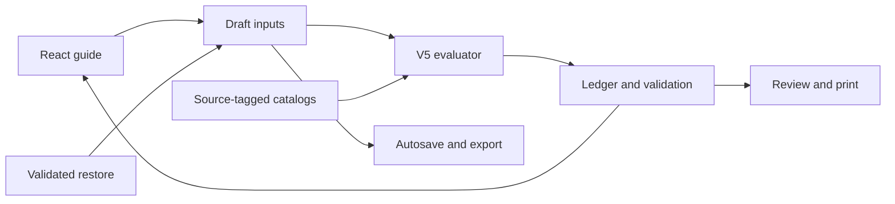

# Architecture

The scaffold is a static Vite app with React, TypeScript, Tailwind CSS, and shadcn/ui. [`index.html`](../index.html) loads [`src/main.tsx`](../src/main.tsx), which mounts the starter screen in [`src/App.tsx`](../src/App.tsx). [`vite.config.ts`](../vite.config.ts) registers React and Tailwind and resolves `@/` to `src/`. The theme is in [`src/index.css`](../src/index.css), and [`components.json`](../components.json) points shadcn/ui to the same stylesheet and alias.

The [product plan](../PLAN.md) describes the modules that follow the scaffold.

| Area | Responsibility |
| --- | --- |
| React guide | Collect draft inputs, expose the live ledger and step navigation, and show review, print, and share previews. |
| `src/rules/` | Evaluate the draft under its V5 ruleset. Calculate totals, list the source of each grant, and attach issues to affected choices. |
| `src/catalog/` | Hold stable option IDs, structured prerequisites and effects, and book and page references. |
| Draft and transfer code | Save named drafts in the browser. Parse and validate versioned backups and mechanical links before preview. |

The reducer stores base allocations, grant selections, and ordered XP purchases. The evaluator derives the sheet, remaining budgets, and open choices. If a clan, Skill distribution, or Predator Type change invalidates a selection, the draft preserves it for review and the evaluator excludes it from the active totals.

A full backup carries the versioned draft. Build links are constructed from an allowlist of mechanical fields and catalog IDs. Import and share previews open before any saved draft changes. The Storyteller brief uses the evaluated sheet and the narrative fields the player selects.

For a new catalog entry, add the source reference, stable ID, and structured effects. For a rules change, update the evaluator and its hand-checked fixtures, then verify the result in the guide and print review. For a transfer change, check round-trips and unsupported input before altering the export format. See [Decisions](decisions.md) and [Development](development.md).
