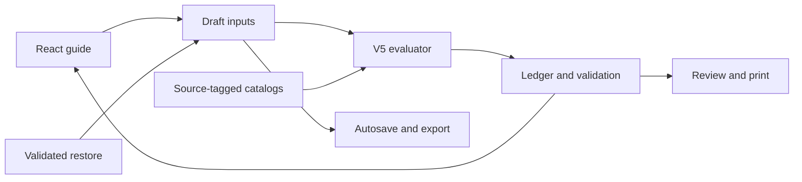

# Architecture

The static Vite app uses React, TypeScript, Tailwind CSS, and shadcn/ui. [`index.html`](../index.html) loads [`src/main.tsx`](../src/main.tsx), which mounts the creator in [`src/App.tsx`](../src/App.tsx). [`vite.config.ts`](../vite.config.ts) registers React and Tailwind and resolves `@/` to `src/`. The theme is in [`src/index.css`](../src/index.css), and [`components.json`](../components.json) points shadcn/ui to the same stylesheet and alias.

The ledger uses stable Attribute and Skill IDs from [`src/catalog/traits.ts`](../src/catalog/traits.ts). Its editor dispatches changes to the in-memory draft in [`src/rules/trait-ledger.ts`](../src/rules/trait-ledger.ts). A pure calculation returns the rating slots, derived tracks, and Specialty eligibility after every edit. The draft retains selections when a distribution change exposes a conflict. Specialties tied to overfilled ratings stay inactive until those ratings fit. The [product plan](../PLAN.md) describes the later modules.

| Area | Responsibility |
| --- | --- |
| React guide | Collect draft inputs, expose the live ledger and step navigation, and show review, print, and share previews. |
| `src/rules/` | Evaluate the draft under its V5 ruleset. Calculate totals, list the source of each grant, and attach issues to affected choices. |
| `src/catalog/` | Hold stable option IDs, structured prerequisites and effects, and book and page references. |
| Draft and transfer code | Save named drafts in the browser. Parse and validate versioned backups and mechanical links before preview. |

The reducer also stores clan and Predator Type choices. [`src/rules/clan-path.ts`](../src/rules/clan-path.ts) resolves them against the [source-tagged catalog](../src/catalog/clan-path.ts), evaluates power slots by acquisition rank, and returns mandatory grants and the Discipline ledger. The Trait evaluator determines whether the Predator Specialty takes effect as a Specialty or as a separate Skill dot. Switching or clearing a choice preserves its saved powers for when the corresponding slot returns. Ordered XP purchases and starting Advantage and Flaw budgets follow in the next milestone.

A full backup carries the versioned draft. Build links are constructed from an allowlist of mechanical fields and catalog IDs. Import and share previews open before any saved draft changes. The Storyteller brief uses the evaluated sheet and the narrative fields the player selects.

For a new catalog entry, add the source reference, stable ID, and structured effects. For a rules change, update the evaluator and its hand-checked fixtures, then verify the result in the guide and print review. For a transfer change, check round-trips and unsupported input before altering the export format. See [Decisions](decisions.md) and [Development](development.md).
